# Rahul Kumar

  

  <b>Architecting small local AI models, deterministic agent systems, and resilient production web applications.</b> 
  Based in Chandigarh, India · Open-weights creator on Hugging Face · Building developer tools that respect context and privacy.

  <b>🚀 Currently open to new opportunities</b> — Full Stack (PHP, NodeJs, Python) / Data Science / Applied AI / Devtools, based in India. 
  Reach me at <a href="mailto:rahul05ranjan@gmail.com">rahul05ranjan@gmail.com</a> or on <a href="https://www.linkedin.com/in/rahulswt7/">LinkedIn</a>.

<!-- Quick Contact & Social Hub -->

  
  
  
  
  
  

---

## ⚡ Executive Summary

I specialize in **Applied AI Engineering** and **Full-Stack Systems**. My recent focus is solving the context window crisis for AI coding agents and building deterministic AI engines powered by compact, open-weights language models that run 100% locally on user hardware.

- 🧠 **Model Creator:** Published **7 specialized open-weights models** on Hugging Face (Hydra Nano family & VIC-2B) with **3,000+ downloads**.
- 🛠️ **Agent Context Optimization:** Creator of **Hydra**, shaving **76% of noise tokens** out of coding agent context windows using local GGUF models.
- 📊 **Deterministic Query Planning:** Developed **VIC-2B** and the **vasuki** engine, achieving **83.0% accuracy on Spider** and matching 120B parameter models at 1.55 GB footprint.
- 💻 **Production Full-Stack:** Scalable, reliable architectures across TypeScript, React, Next.js, Node.js, Python, PHP, and Docker.

---

## 🚀 Featured Flagship Projects

<table>
  <tr>
    <td width="50%" valign="top">
      <h3 align="center">🐉 <a href="https://github.com/rahul05ranjan/hydra">Hydra</a></h3>
      

        <b>Small Local Models That Take the Noisy Work Off Coding Agents</b> 
        
        
        
      

      <ul>
        <li><b>Context Savior:</b> Intercepts verbose tool outputs (test suites, build logs, git diffs, process lists) using fine-tuned 0.8B/0.9B local models running on <code>llama.cpp</code>.</li>
        <li><b>Proven Efficiency:</b> Filters out <b>76% of token waste</b> (e.g. compressing a ~13,800 token test run into 57 critical failure tokens).</li>
        <li><b>Harness Integrations:</b> Seamlessly hooks into <b>Claude Code, Cursor, Codex, OpenCode, Gemini CLI</b>, and MCP-compatible clients.</li>
        <li><b>Zero Data Leaks:</b> 100% local, read-only telemetry in local ledger, zero cloud dependency.</li>
      </ul>
      

        <code>npx hydra-nano</code> · <a href="https://github.com/rahul05ranjan/hydra"><b>Explore Repository →</b></a>
      

    </td>
    <td width="50%" valign="top">
      <h3 align="center">⚡ <a href="https://github.com/rahul05ranjan/vasuki-vic">Vasuki & VIC-2B</a></h3>
      

        <b>Deterministic Tabular Query Engine & 1.55 GB Planner Model</b> 
        
        
        
      

      <ul>
        <li><b>Auditable Planning:</b> Translates plain English and Hinglish queries into typed, 12-operation JSON execution plans without hallucinated code or unsafe <code>eval</code>.</li>
        <li><b>Frontier-Level Benchmarks:</b> Fine-tuned on Qwen3.5-2B, achieving <b>83.0% on Spider</b> and <b>66.7% on BIRD</b>, matching a 120B model at a fraction of compute.</li>
        <li><b>Multi-Format Runner:</b> Operates on <code>.csv</code>, <code>.tsv</code>, <code>.json</code>, and <code>.jsonl</code> with zero third-party dependencies outside Python stdlib.</li>
        <li><b>MCP & Agent Skill:</b> Native CLI, Python API, Ollama support, and MCP server for agentic integration.</li>
      </ul>
      

        <code>uvx --from git+https://github.com/rahul05ranjan/vasuki-vic vasuki ask</code> · <a href="https://github.com/rahul05ranjan/vasuki-vic"><b>Explore Repository →</b></a>
      

    </td>
  </tr>
  <tr>
    <td width="50%" valign="top">
      <h3 align="center">🤗 <a href="https://huggingface.co/rahul05ranjan">Open-Weights Models Ecosystem</a></h3>
      

        <b>Specialized Compact Models Fine-Tuned for Autonomous Workflows</b> 
        
      

      <ul>
        <li><a href="https://huggingface.co/rahul05ranjan/hydra-nano-git"><b>hydra-nano-git</b></a> (0.8B Q8_0 GGUF): Specializes in git diffs, commit history, and blame extraction (1.4k+ downloads).</li>
        <li><a href="https://huggingface.co/rahul05ranjan/hydra-nano-test"><b>hydra-nano-test</b></a> (0.9B): Test runner log digesting across 8 frameworks with 97.5% task solve rate.</li>
        <li><a href="https://huggingface.co/rahul05ranjan/hydra-nano-os"><b>hydra-nano-os</b></a>, <b>read</b> & <b>files</b>: System inspection, symbol extraction, and AST-aware file localization.</li>
        <li><a href="https://huggingface.co/rahul05ranjan/VIC-2B"><b>VIC-2B</b></a> & <a href="https://huggingface.co/rahul05ranjan/VIC-2B-GGUF"><b>VIC-2B-GGUF</b></a>: Deterministic data planner with Ollama ready-to-run package.</li>
      </ul>
      

        <a href="https://huggingface.co/rahul05ranjan"><b>View Models on Hugging Face →</b></a>
      

    </td>
    <td width="50%" valign="top">
      <h3 align="center">🛡️ <a href="https://github.com/rahul05ranjan/dhruv-cli">Dhruv CLI</a></h3>
      

        <b>Local-First AI Command Center for Terminal Developers</b> 
        
        
      

      <ul>
        <li><b>Offline AI Terminal:</b> Powers terminal workflows with local LLMs via Ollama, keeping sensitive proprietary code off external servers.</li>
        <li><b>Intelligent Tooling:</b> Automated security scans, code reviews, unit test generation, and natural-language command translation.</li>
        <li><b>Modular Architecture:</b> Built with TypeScript and Node.js featuring an extensible third-party plugin ecosystem.</li>
      </ul>
      

        <code>npm install -g @rahul05ranjan/dhruv-cli</code> · <a href="https://github.com/rahul05ranjan/dhruv-cli"><b>Explore Repository →</b></a>
      

    </td>
  </tr>
</table>

---

## 🏆 Merged Into Flagship Open-Source Projects (5K+ ⭐)

**Every pull request below was opened, reviewed, and merged by the project maintainers — verified contributions in repositories with 5,000+ GitHub stars.**

### 🥇 The 50K+ ⭐ League

| Project | ⭐ | Merged PRs |
|:---|:---:|:---|
| [thedotmack/claude-mem](https://github.com/thedotmack/claude-mem) |  | [#4457](https://github.com/thedotmack/claude-mem/pull/4457) |
| [Panniantong/Agent-Reach](https://github.com/Panniantong/Agent-Reach) |  | [#779](https://github.com/Panniantong/Agent-Reach/pull/779) |
| [Ebony-Vinyl/dsh-our-free-model](https://github.com/Ebony-Vinyl/dsh-our-free-model) |  | [#675](https://github.com/Ebony-Vinyl/dsh-our-free-model/pull/675) |
| [OpenMontageInc/OpenMontage](https://github.com/OpenMontageInc/OpenMontage) |  | [#713](https://github.com/OpenMontageInc/OpenMontage/pull/713) |
| [openai/openai-cookbook](https://github.com/openai/openai-cookbook) |  | [#3133](https://github.com/openai/openai-cookbook/pull/3133) |
| [cathrynlavery/diagram-design](https://github.com/cathrynlavery/diagram-design) |  | [#413](https://github.com/cathrynlavery/diagram-design/pull/413) |
| [coreyhaines31/marketingskills](https://github.com/coreyhaines31/marketingskills) |  | [#928](https://github.com/coreyhaines31/marketingskills/pull/928) · [#927](https://github.com/coreyhaines31/marketingskills/pull/927) |
| [HKUDS/DeepTutor](https://github.com/HKUDS/DeepTutor) |  | [#2351](https://github.com/HKUDS/DeepTutor/pull/2351) |

### 🚀 10K–50K ⭐

| Project | ⭐ | Merged PRs |
|:---|:---:|:---|
| [NandhaKishorM/laya](https://github.com/NandhaKishorM/laya) |  | [#1446](https://github.com/NandhaKishorM/laya/pull/1446) · [#1445](https://github.com/NandhaKishorM/laya/pull/1445) · [#1394](https://github.com/NandhaKishorM/laya/pull/1394) · [#1392](https://github.com/NandhaKishorM/laya/pull/1392) · [#682](https://github.com/NandhaKishorM/laya/pull/682) · [#609](https://github.com/NandhaKishorM/laya/pull/609) · [#480](https://github.com/NandhaKishorM/laya/pull/480) |
| [guillaumemeyer/watermarks-remover](https://github.com/guillaumemeyer/watermarks-remover) |  | [#402](https://github.com/guillaumemeyer/watermarks-remover/pull/402) · [#401](https://github.com/guillaumemeyer/watermarks-remover/pull/401) · [#400](https://github.com/guillaumemeyer/watermarks-remover/pull/400) |
| [storytold/pdfcraft](https://github.com/storytold/pdfcraft) |  | [#5736](https://github.com/storytold/pdfcraft/pull/5736) · [#3621](https://github.com/storytold/pdfcraft/pull/3621) |
| [storytold/filmcraft](https://github.com/storytold/filmcraft) |  | [#3964](https://github.com/storytold/filmcraft/pull/3964) · [#3960](https://github.com/storytold/filmcraft/pull/3960) · [#3483](https://github.com/storytold/filmcraft/pull/3483) · [#3435](https://github.com/storytold/filmcraft/pull/3435) · [#2568](https://github.com/storytold/filmcraft/pull/2568) |
| [storytold/wordcraft](https://github.com/storytold/wordcraft) |  | [#5291](https://github.com/storytold/wordcraft/pull/5291) |
| [langchain-ai/openwiki](https://github.com/langchain-ai/openwiki) |  | [#1052](https://github.com/langchain-ai/openwiki/pull/1052) |
| [LibreTranslate/LibreTranslate](https://github.com/LibreTranslate/LibreTranslate) |  | [#1016](https://github.com/LibreTranslate/LibreTranslate/pull/1016) |
| [storytold/lightcraft](https://github.com/storytold/lightcraft) |  | [#3604](https://github.com/storytold/lightcraft/pull/3604) |
| [josdejong/mathjs](https://github.com/josdejong/mathjs) |  | [#3781](https://github.com/josdejong/mathjs/pull/3781) |
| [Gallopsled/pwntools](https://github.com/Gallopsled/pwntools) |  | [#2795](https://github.com/Gallopsled/pwntools/pull/2795) |
| [seerr-team/seerr](https://github.com/seerr-team/seerr) |  | [#3564](https://github.com/seerr-team/seerr/pull/3564) |
| [dsh-market/dsh-market](https://github.com/dsh-market/dsh-market) |  | [#1080](https://github.com/dsh-market/dsh-market/pull/1080) · [#1079](https://github.com/dsh-market/dsh-market/pull/1079) · [#1045](https://github.com/dsh-market/dsh-market/pull/1045) · [#1032](https://github.com/dsh-market/dsh-market/pull/1032) |
| [CopilotKit/OpenBot](https://github.com/CopilotKit/OpenBot) |  | [#848](https://github.com/CopilotKit/OpenBot/pull/848) |
| [storytold/vectorcraft](https://github.com/storytold/vectorcraft) |  | [#5242](https://github.com/storytold/vectorcraft/pull/5242) · [#5240](https://github.com/storytold/vectorcraft/pull/5240) · [#4310](https://github.com/storytold/vectorcraft/pull/4310) · [#4308](https://github.com/storytold/vectorcraft/pull/4308) · [#3203](https://github.com/storytold/vectorcraft/pull/3203) |
| [KKKKhazix/AIHOT](https://github.com/KKKKhazix/AIHOT) |  | [#275](https://github.com/KKKKhazix/AIHOT/pull/275) · [#274](https://github.com/KKKKhazix/AIHOT/pull/274) |
| [mobile-next/mobile-mcp](https://github.com/mobile-next/mobile-mcp) |  | [#451](https://github.com/mobile-next/mobile-mcp/pull/451) |
| [lnkiai/m3e-canvas](https://github.com/lnkiai/m3e-canvas) |  | [#481](https://github.com/lnkiai/m3e-canvas/pull/481) · [#479](https://github.com/lnkiai/m3e-canvas/pull/479) |
| [crmne/spotifast](https://github.com/crmne/spotifast) |  | [#1095](https://github.com/crmne/spotifast/pull/1095) |
| [py-pdf/pypdf](https://github.com/py-pdf/pypdf) |  | [#4389](https://github.com/py-pdf/pypdf/pull/4389) · [#4388](https://github.com/py-pdf/pypdf/pull/4388) · [#4286](https://github.com/py-pdf/pypdf/pull/4286) · [#4284](https://github.com/py-pdf/pypdf/pull/4284) |

### 💎 5K–10K ⭐

| Project | ⭐ | Merged PRs |
|:---|:---:|:---|
| [miqdadbadjuber/anti-slop](https://github.com/miqdadbadjuber/anti-slop) |  | [#50](https://github.com/miqdadbadjuber/anti-slop/pull/50) |
| [rehan-remade/universal-modder](https://github.com/rehan-remade/universal-modder) |  | [#442](https://github.com/rehan-remade/universal-modder/pull/442) |
| [tobymao/sqlglot](https://github.com/tobymao/sqlglot) |  | [#8827](https://github.com/tobymao/sqlglot/pull/8827) |
| [storytold/effectcraft](https://github.com/storytold/effectcraft) |  | [#2825](https://github.com/storytold/effectcraft/pull/2825) · [#2819](https://github.com/storytold/effectcraft/pull/2819) |
| [kellyjonbrazil/jc](https://github.com/kellyjonbrazil/jc) |  | [#914](https://github.com/kellyjonbrazil/jc/pull/914) · [#913](https://github.com/kellyjonbrazil/jc/pull/913) · [#798](https://github.com/kellyjonbrazil/jc/pull/798) |
| [storytold/cadcraft](https://github.com/storytold/cadcraft) |  | [#2638](https://github.com/storytold/cadcraft/pull/2638) · [#2636](https://github.com/storytold/cadcraft/pull/2636) |
| [microsoft/TokenEconomizer](https://github.com/microsoft/TokenEconomizer) |  | [#183](https://github.com/microsoft/TokenEconomizer/pull/183) · [#181](https://github.com/microsoft/TokenEconomizer/pull/181) |
| [Louis-CFM/coucou](https://github.com/Louis-CFM/coucou) |  | [#947](https://github.com/Louis-CFM/coucou/pull/947) · [#944](https://github.com/Louis-CFM/coucou/pull/944) |
| [jarun/buku](https://github.com/jarun/buku) |  | [#923](https://github.com/jarun/buku/pull/923) · [#922](https://github.com/jarun/buku/pull/922) |
| [PyCQA/isort](https://github.com/PyCQA/isort) |  | [#2764](https://github.com/PyCQA/isort/pull/2764) |
| [bethington/ghidra-mcp](https://github.com/bethington/ghidra-mcp) |  | [#647](https://github.com/bethington/ghidra-mcp/pull/647) · [#646](https://github.com/bethington/ghidra-mcp/pull/646) |
| [mayswind/ezbookkeeping](https://github.com/mayswind/ezbookkeeping) |  | [#747](https://github.com/mayswind/ezbookkeeping/pull/747) · [#746](https://github.com/mayswind/ezbookkeeping/pull/746) |
| [codeigniter4/CodeIgniter4](https://github.com/codeigniter4/CodeIgniter4) |  | [#10606](https://github.com/codeigniter4/CodeIgniter4/pull/10606) |
| [tigerless-labs/cost-xray](https://github.com/tigerless-labs/cost-xray) |  | [#64](https://github.com/tigerless-labs/cost-xray/pull/64) · [#63](https://github.com/tigerless-labs/cost-xray/pull/63) |

---

## 🌐 Open Source Contributions

I contribute fixes, reviews, and QA upstream to the projects I build on — not just my own.

<!-- proof-links-start -->
**Live proof — every figure links to the always-current full list:**

- 🔀 [**210+ Open Pull Requests**](https://github.com/search?q=is%3Apr+is%3Aopen+author%3Arahul05ranjan+-user%3Arahul05ranjan+archived%3Afalse&type=pullrequests) — fixes awaiting or in maintainer review across open-source repos
- ✅ [**310+ Merged Pull Requests**](https://github.com/search?q=is%3Apr+is%3Amerged+author%3Arahul05ranjan+-user%3Arahul05ranjan+archived%3Afalse&type=pullrequests) — accepted by upstream maintainers
- 🔍 [**840+ Code Reviews**](https://github.com/search?q=is%3Apr+reviewed-by%3Arahul05ranjan+-user%3Arahul05ranjan+archived%3Afalse&type=pullrequests) — verified reviews on other maintainers' pull requests
- 🎫 [**250+ Open Issue Tickets**](https://github.com/search?q=is%3Aissue+is%3Aopen+author%3Arahul05ranjan+-user%3Arahul05ranjan&type=issues) — reproducible bug reports filed upstream
<!-- proof-links-end -->

- **Merged PRs — 310+ across 30+ public repos**, including [openai/openai-cookbook](https://github.com/openai/openai-cookbook), [LibreTranslate](https://github.com/LibreTranslate/LibreTranslate), [spatie/twitter-labs](https://github.com/spatie/twitter-labs), [mobile-next/mobile-mcp](https://github.com/mobile-next/mobile-mcp), and [guillaumemeyer/watermarks-remover](https://github.com/guillaumemeyer/watermarks-remover) (3).
<!-- active-review-start -->
- **PRs in active maintainer review:** [khuisman/mcp-gee-sweet#1610](https://github.com/khuisman/mcp-gee-sweet/pull/1610) · [khuisman/mcp-gee-sweet#1609](https://github.com/khuisman/mcp-gee-sweet/pull/1609) · [khuisman/mcp-gee-sweet#1587](https://github.com/khuisman/mcp-gee-sweet/pull/1587) · [khuisman/mcp-gee-sweet#1586](https://github.com/khuisman/mcp-gee-sweet/pull/1586) · [asciimoo/exrex#81](https://github.com/asciimoo/exrex/pull/81)
<!-- active-review-end -->
- **Code review at depth:** 100+ verified code reviews on open-source pull requests. Recent catches: a 366-day duplicate-month calendar bug, a regex regression that silently broke no-space time formats, and a hot-path O(n) rewrite flagged before merge.
- **QA that ships:** 250+ reproducible bug reports filed; fixes already merged by maintainers in [caronc/apprise](https://github.com/caronc/apprise), [shaongitbd/doory](https://github.com/shaongitbd/doory), [KKKKhazix/AIHOT](https://github.com/KKKKhazix/AIHOT) and others.

---

## 🛠️ Technical Capabilities & Stack

| Domain | Core Competencies & Tools |
| :--- | :--- |
| **Applied AI & Local LLMs** | Fine-tuning compact SLMs (0.8B–2B), Qwen3.5, Llama, Ollama, llama.cpp, MLX, GGUF quantization, OpenCV |
| **Agentic Frameworks & Context** | Model Context Protocol (MCP), tool output sandboxing, context token compression, deterministic planning |
| **Frontend & Interfaces** | Next.js, React, TypeScript, JavaScript, Tailwind CSS, Bootstrap, Responsive UI/UX |
| **Backend & APIs** | Node.js, Express, Python, PHP, Laravel, RESTful APIs, WebSockets, CLI development |
| **Databases & DevOps** | MySQL, MongoDB, Docker, Git/GitHub Actions, Linux/macOS runtime environments |

 

  

---

## 📊 Engineering Activity & Impact

  
  

  

### 🐍 Contribution Activity

  

---

## 🤝 Let's Connect & Collaborate

Whether you're exploring **compact AI model deployments**, building **agentic workflows that don't burn tokens**, or need a **dependable full-stack application built from zero to production**, let's talk.

  Direct Mobile / WhatsApp / Arattai: <a href="tel:+917004541481"><strong>+91 7004541481</strong></a> · Email: <a href="mailto:rahul05ranjan@gmail.com">rahul05ranjan@gmail.com</a>

---

  
  
  

  Designed with precision · Open-source enthusiast · Built by Rahul Kumar

